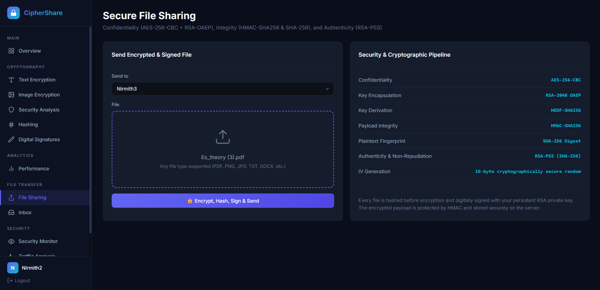
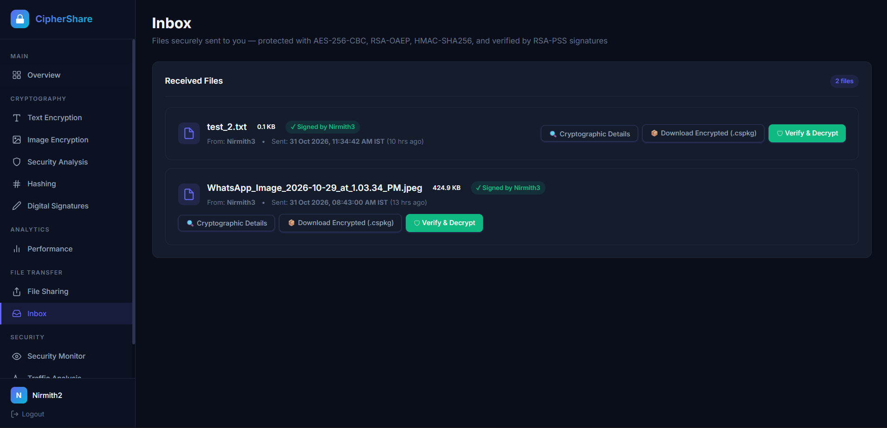
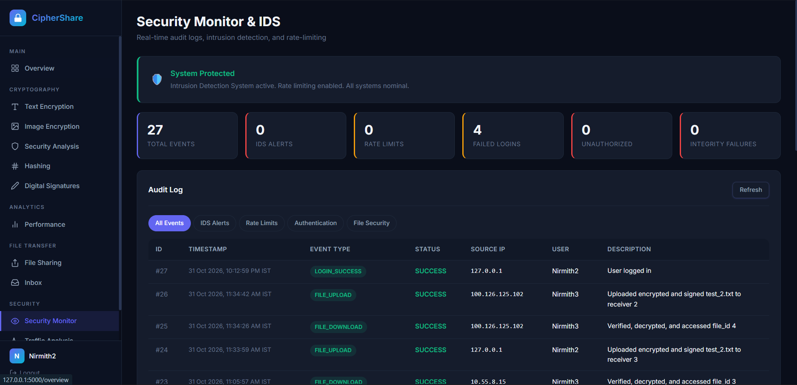
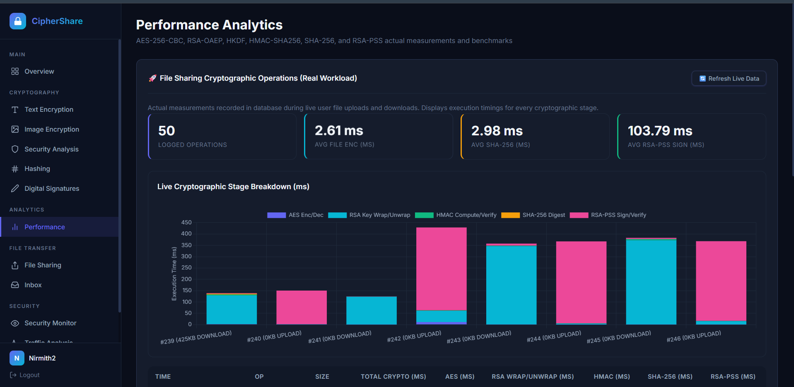
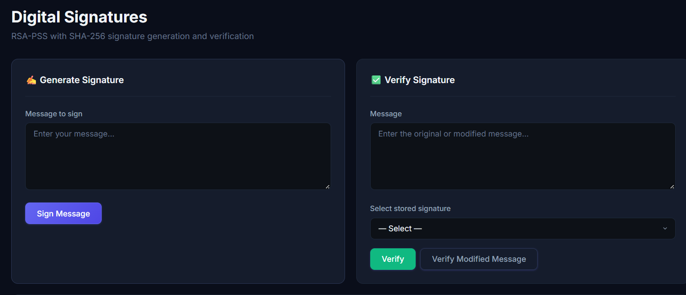
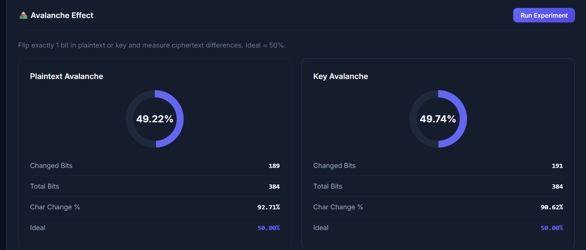
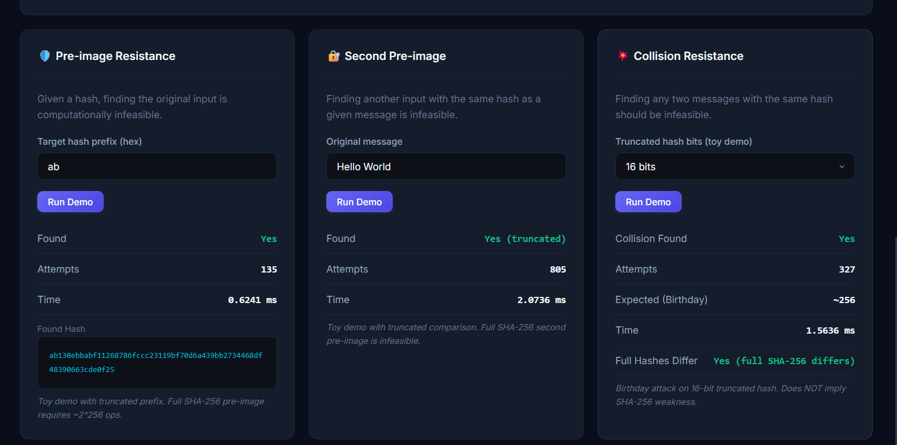
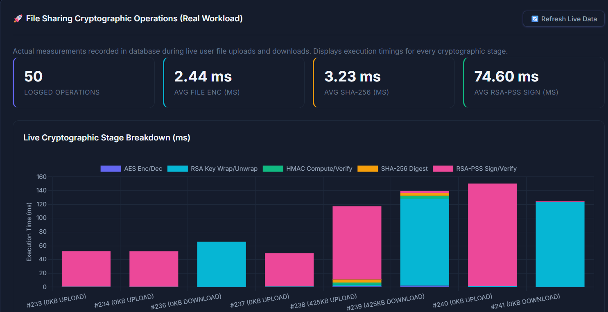

# CipherShare 🔐
### Secure Multi-Device File Sharing System

CipherShare is a Flask-based secure file-sharing application that enables users to transfer files between devices over a network while maintaining confidentiality, integrity, authentication and accountability.

It combines symmetric and asymmetric cryptography with integrity verification, digital signatures, audit logging and network traffic analysis to provide a secure file-sharing environment.

---

## 🚀 Key Features

### 1. Secure File Sharing
- Upload and share files between registered users.
- Receiver-specific file authorization.
- Multi-device communication over a local network.
- Support for different file types, including documents, images, audio and video.

### 2. Cryptographic Security

| Security mechanism | Algorithm / Technique | Purpose |
|---|---|---|
| File encryption | AES-256-CBC | Confidentiality |
| AES key protection | RSA-2048 with OAEP | Secure key exchange |
| Key derivation | HKDF | Derivation of cryptographic keys |
| Integrity verification | HMAC-SHA256 | Detect unauthorized modification |
| Password storage | Werkzeug password hashing | Secure password storage |
| Digital signatures | RSA-PSS | Verify file authenticity |

### 3. Authentication and Authorization
- User registration and login.
- Secure password hashing.
- User-specific RSA key pairs.
- Encrypted private-key storage.
- Sender and receiver authorization.

### 4. Digital Signatures
- Generate digital signatures for file hashes.
- Verify signatures using the corresponding public key.
- Detect modifications to signed content.

### 5. Security Monitoring and Audit Logs
- Record important security-related events.
- Monitor authentication attempts.
- Track file-sharing activities.
- Log unauthorized access attempts and integrity failures.

### 6. Network Traffic Analysis
- Analyze network traffic using Wireshark and PyShark.
- Monitor traffic activity and transfer patterns.
- Visualize traffic statistics.
- Compare traffic characteristics.

### 7. Performance Analytics
- Measure encryption and decryption performance.
- Evaluate file-transfer duration.
- Analyze throughput and cryptographic overhead.
- Display performance results through visual dashboards.

### 8. Additional Cryptographic Modules
- Text encryption and decryption.
- Image encryption and decryption.
- SHA-256 hashing.
- Confusion and diffusion analysis.
- Avalanche effect analysis.

---
## 📸 Application Screenshots

### Secure File Sharing


### Inbox


### Security Monitoring & Intrusion Detection


### Performance Analytics


### Digital Signatures


### Cryptographic Analysis

**Avalanche Effect**



**Hash Security Analysis**



### Cryptographic Performance



## 🛠️ Technology Stack

| Category | Technologies |
|---|---|
| Backend | Python, Flask |
| Frontend | HTML, CSS, JavaScript |
| Database | SQLite |
| Symmetric cryptography | AES-256-CBC |
| Asymmetric cryptography | RSA-2048, RSA-OAEP |
| Integrity | HMAC-SHA256, HKDF |
| Digital signatures | RSA-PSS |
| Network analysis | Wireshark, PyShark |
| Visualization | Chart.js, Matplotlib |
| Testing | Pytest |

---

## 🏗️ System Architecture

CipherShare follows a monolithic Flask architecture with SQLite as its database.

```text
             DEVICE A
          (Sender / Laptop)
                 |
                 |
          Flask Application
                 |
      +----------+----------+
      |          |          |
 Authentication  Crypto    Audit Logs
      |          |          |
      |     AES-256-CBC     |
      |     RSA-OAEP        |
      |     HMAC-SHA256     |
      |     RSA-PSS         |
      |          |          |
      +----------+----------+
                 |
             SQLite DB
                 |
          Network (Wi-Fi)
                 |
          Flask Application
                 |
             DEVICE B
          (Receiver / Mobile)
```

---

## 🔐 Cryptographic Workflow

### File Encryption and Key Protection

1. The sender selects a file for sharing.
2. The application generates a random AES-256 key and initialization vector (IV).
3. The file is encrypted using AES-256-CBC.
4. An HMAC-SHA256 key is derived using HKDF.
5. HMAC is calculated to protect the encrypted file against unauthorized modification.
6. The receiver's RSA public key encrypts the AES key using RSA-OAEP.
7. The encrypted file and associated cryptographic metadata are stored.

### File Decryption and Integrity Verification

1. The receiver requests an authorized file.
2. The receiver's RSA private key decrypts the protected AES key.
3. The application derives the HMAC key using HKDF.
4. HMAC verification is performed before decryption.
5. If integrity verification succeeds, AES decryption is performed.
6. The original file is returned to the receiver.

---

## 💻 Installation and Setup

### Prerequisites

- Python 3.10 or later
- Git
- pip
- Wireshark (optional, for network traffic analysis)

### 1. Clone the Repository

```bash
git clone https://github.com/NirmithM06/CipherShare.git
cd CipherShare
```

### 2. Create a Virtual Environment

**Windows PowerShell:**

```powershell
python -m venv venv
.\venv\Scripts\Activate.ps1
```

**Linux / macOS:**

```bash
python3 -m venv venv
source venv/bin/activate
```

### 3. Install Dependencies

```bash
pip install -r requirements.txt
```

### 4. Configure the Secret Key

The application requires a Flask secret key through an environment variable.

**Windows PowerShell:**

```powershell
$env:SECRET_KEY = (python -c "import secrets; print(secrets.token_hex(32))")
```

**Linux / macOS:**

```bash
export SECRET_KEY=$(python -c "import secrets; print(secrets.token_hex(32))")
```

Generate and securely store a persistent secret for deployments rather than generating a new one every time.

### 5. Run the Application

```bash
python app.py
```

Open the application in your browser:

```text
http://localhost:5000
```

For access from another device on the same network, use the LAN address displayed in the server terminal.

---

## 🧪 Testing

CipherShare includes automated tests covering different application components.

Run the test suite using:

```bash
pytest
```

The tests cover areas such as:

- Authentication and authorization.
- Encryption and decryption.
- File-sharing workflows.
- Integrity verification.
- Unauthorized access prevention.
- Digital security validation.
- Performance and traffic analysis.

---

## 📁 Project Structure

```text
CipherShare/
│
├── app.py
├── config.py
├── requirements.txt
│
├── core/
│   ├── audit.py
│   ├── auth.py
│   ├── collector.py
│   ├── crypto.py
│   ├── crypto_utils.py
│   ├── routes.py
│   ├── security.py
│   └── time_utils.py
│
├── database/
│   ├── db_schema.sql
│   ├── migrate_schema.py
│   └── models.py
│
├── performance/
│   ├── benchmark.py
│   ├── README.md
│   └── results/
│
├── static/
│   └── css/
│       └── style.css
│
├── templates/
│
├── traffic_analysis/
│   ├── analyzer.py
│   ├── comparator.py
│   ├── README.md
│   └── results/
│
└── test_*.py
```

---

## 🔒 Security Considerations

- Never commit environment secrets, passwords, private keys or database files.
- Private keys are encrypted at rest using user passwords.
- File access is restricted to authorized users.
- HMAC verification is performed to detect ciphertext modification.
- Use HTTPS and a production WSGI server when deploying beyond a local academic demonstration.
- Network traffic analysis may require additional Wireshark/TShark configuration and permissions.

**Note:** CipherShare is an academic project and should undergo further security review before production deployment.

---

## 👨‍💻 Author

**Nirmith**

B.Tech – Information Technology  
Manipal Institute of Technology, Manipal

GitHub: [NirmithM06](https://github.com/NirmithM06)

---

## 📜 License

No open-source license has been selected yet. All rights are reserved by default unless a license is added to this repository.
